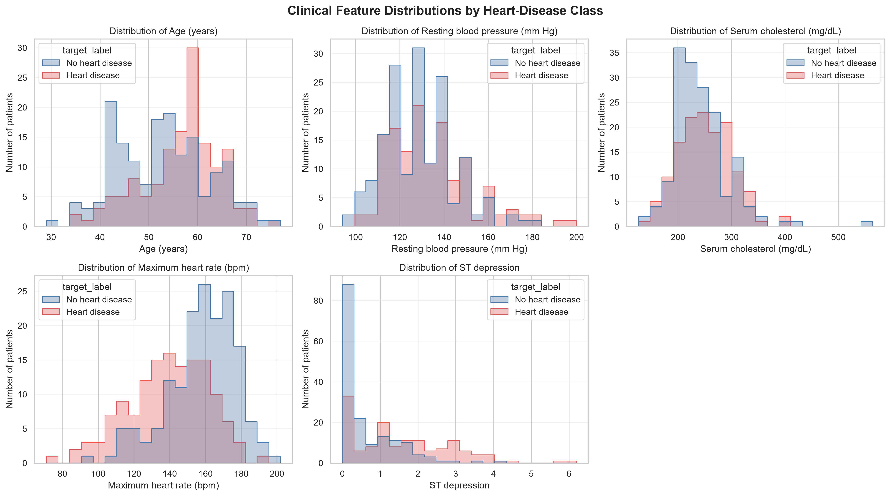
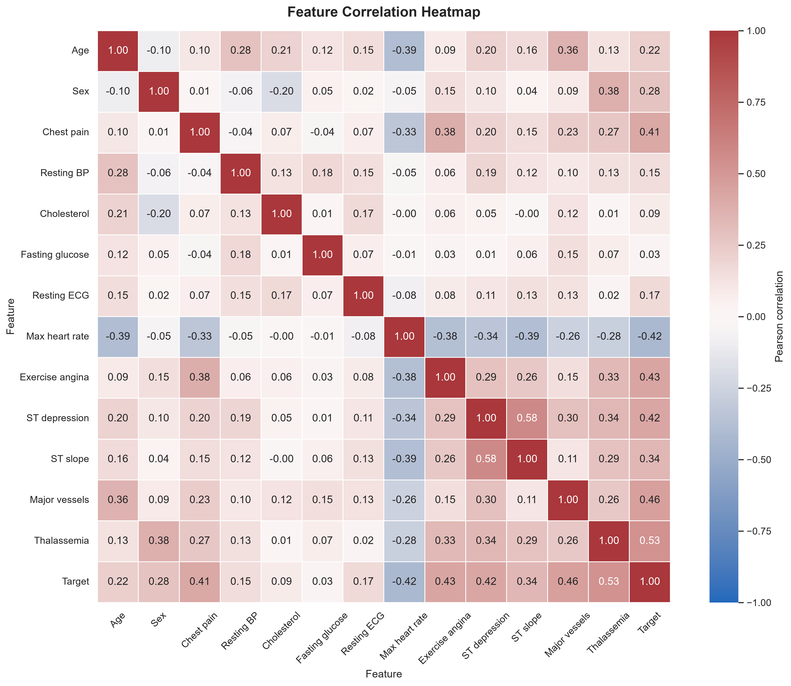

**Student Name:** Pitchaimani N | **Student ID:** 2025AE05341 | **Course No:** AIMLCZG523 / AIMLZG523 | **Course Title:** MLOps - Assignment 1

# Heart Disease Prediction MLOps Project Report

## 1. Project summary

This project demonstrates an end-to-end machine-learning workflow for the
Cleveland Heart Disease dataset: data download and cleaning, exploratory data
analysis, model comparison and MLflow tracking, a validated FastAPI endpoint
with a metrics monitoring interface, Docker packaging, Kubernetes deployment,
and GitHub Actions automation.

The classifier is for coursework and demonstration only. It is not a medical
device and its outputs must not be used for diagnosis, treatment, or clinical
decision-making.

## 2. Workflow and components

1. `download.py` downloads the UCI source file, audits missing values, maps the
   original outcome to a binary target, and writes the prepared CSV.
2. `notebooks/eda.ipynb` inspects the prepared data and produces labeled
   feature histograms, a correlation heatmap, and a target class-balance chart.
3. `train.py` compares Logistic Regression and Random Forest pipelines, logs
   experiments and ROC plots to MLflow, and saves the selected fitted pipeline.
4. `api/main.py` serves `/health`, `/metrics`, and `/predict`; `tests/test_app.py`
   checks unit tests for data processing, model pipeline imputation, successful requests,
   and input validation.
5. The Docker image packages the API and trained model. Kubernetes runs two
   API pods behind a Service.
6. `.github/workflows/main.yml` repeats download, training, lint, and tests on
   GitHub Actions and uploads generated training outputs.

## 3. Dataset preparation and EDA

The cleaned Cleveland dataset contains 303 records, 13 predictor columns, and
one binary target. Target 0 indicates no disease in the source label mapping;
target 1 groups original Cleveland outcome values 1-4 as disease. The observed
class counts are:

| Target | Meaning | Records | Share |
| --- | --- | ---: | ---: |
| 0 | No heart disease | 164 | 54.13% |
| 1 | Heart disease | 139 | 45.87% |

There are six missing predictor values in the source: four in `ca` and two in
`thal`. They are retained in the cleaned data and handled by median imputation
inside each model pipeline. The class proportions are reasonably close, and
the training code uses stratified splitting and cross-validation to preserve
the class mix.

The EDA notebook saves the following figures:






The charts describe this small, historical dataset; they do not establish
clinical relationships or generalize results to a current patient population.
Histograms are useful here because they reveal each variable's observed range,
shape, and potential skew. The heatmap summarizes pairwise linear association;
it is descriptive rather than causal, and encoded clinical categories should
not automatically be interpreted as continuous measurements. The class-count
chart makes the target distribution visible and supports the use of
stratification during validation.

## 4. Model training and evaluation

Both candidates use a leakage-aware scikit-learn pipeline with median
imputation and standard scaling. A stratified 80/20 train/test split uses
`random_state=42`. Each candidate also receives five-fold stratified
cross-validation on the training split. The metrics below are from the
project's latest local MLflow runs and held-out test split:

| Model | CV ROC-AUC (mean +/- SD) | Test accuracy | Test precision | Test recall | Test ROC-AUC |
| --- | ---: | ---: | ---: | ---: | ---: |
| Logistic Regression | 0.8960 +/- 0.0148 | 0.8689 | 0.8125 | 0.9286 | 0.9513 |
| Random Forest | 0.8818 +/- 0.0281 | 0.9016 | 0.8667 | 0.9286 | 0.9491 |

The training script selects the candidate with the highest held-out test
ROC-AUC; therefore Logistic Regression is selected in this run and saved as
`models/heart_disease_pipeline.joblib`. It has the slightly higher test
ROC-AUC, while Random Forest has higher accuracy and precision. Since the
held-out test split is also used for model selection, these test metrics may be
optimistic and should not be treated as unbiased final performance estimates.
Accuracy is the fraction of correct classifications, precision is the fraction
of predicted-positive cases that were positive in the test labels, and recall
is the fraction of positive test cases recovered by the model. ROC-AUC measures
ranking across thresholds; it does not establish calibration or clinical
utility. The saved training summary is `models/training_summary.json`.

MLflow experiment runs are stored in the local `mlruns/` directory, which is
excluded from Git. The GitHub Actions workflow uploads its own run's
model, summary, candidate artifacts, ROC plots, and MLflow data for 14 days.

## 5. API, monitoring, and privacy-conscious logging

The FastAPI service exposes:

- `GET /health` to confirm the model can be loaded.
- `GET /metrics` to return real-time operational counters (`total_requests`,
  `health_requests`, `predict_requests`, `predictions_generated`,
  `validation_errors_422`, and `uptime_seconds`).
- `POST /predict` to return a binary prediction, a class-1 probability, and a
  plain-language prediction label.

The request schema rejects unknown fields (including `target`), category
codes outside those observed in the training data, and continuous values
outside the observed dataset ranges. These are dataset constraints, not
clinical limits. The model response is not medical advice or a diagnosis.

Application logging records the endpoint, HTTP method/status, and a generic
event when a prediction is generated. It intentionally does not log request
fields, patient values, prediction class, probability, or caller identity.
Uvicorn access logging is disabled in the documented local and container
commands to avoid adding client IP addresses. This reduces sensitive
information in application logs; it does not make the API suitable for
processing real patient data.

The logging behavior and metrics are covered by unit tests that verify successful request
and prediction events appear without feature names or example field values.
To inspect logs during local operation, use the server terminal or
`docker logs heart-disease-api`. In Kubernetes, use:

```powershell
kubectl logs deployment/heart-disease-api