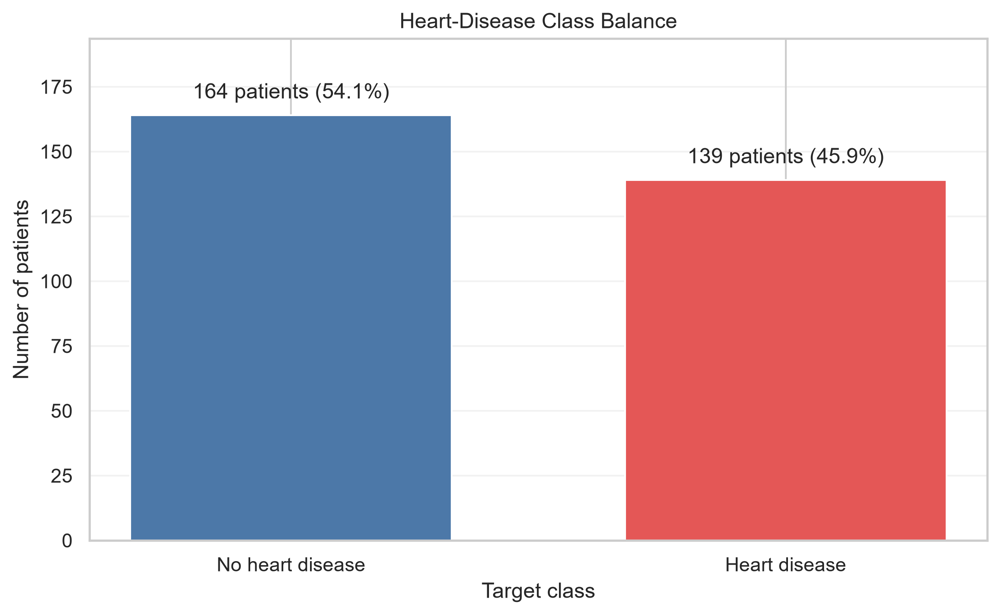
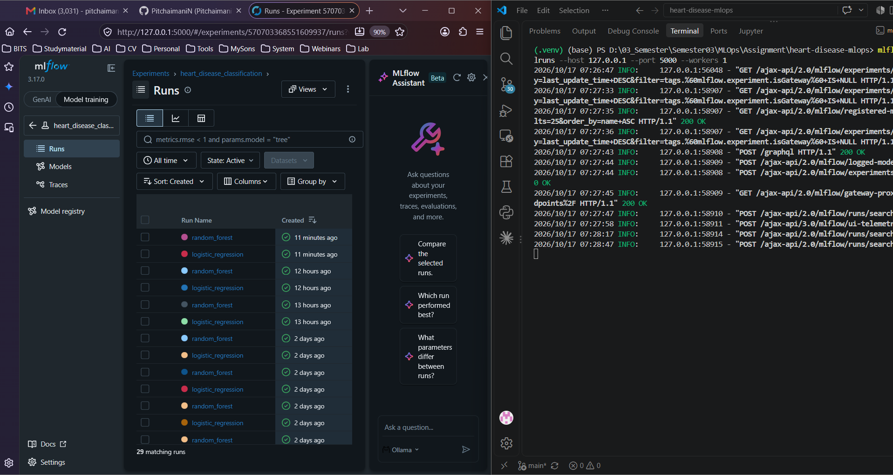
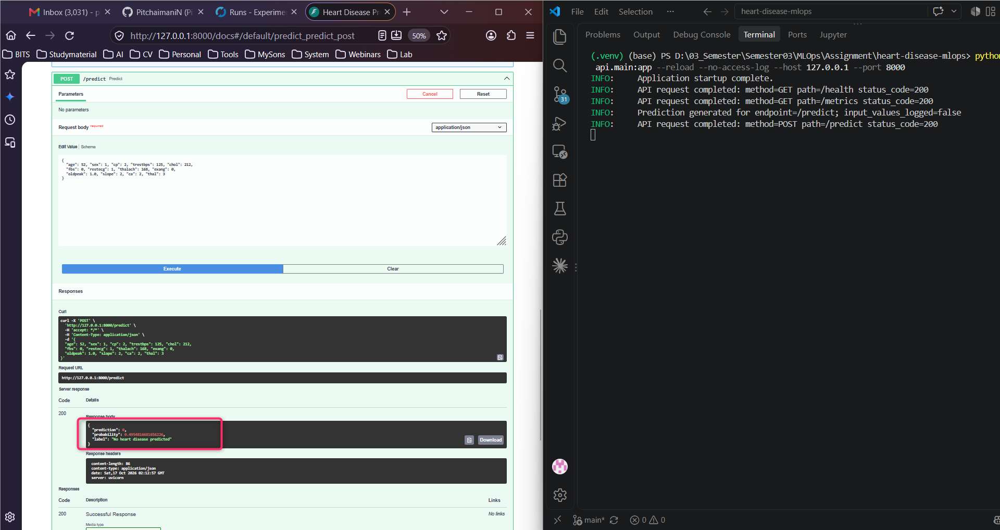
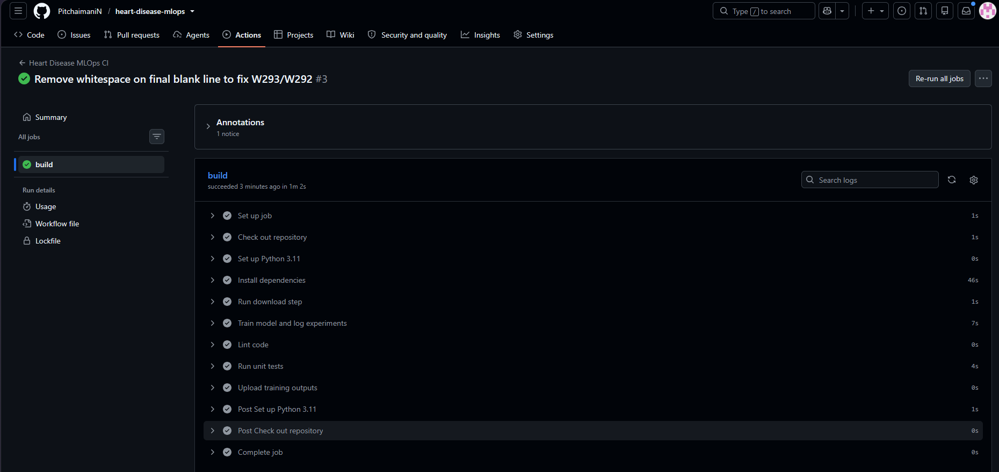
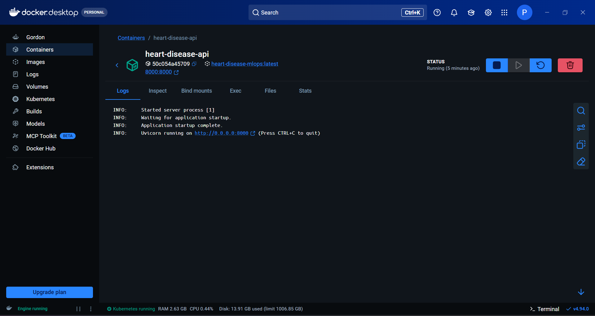
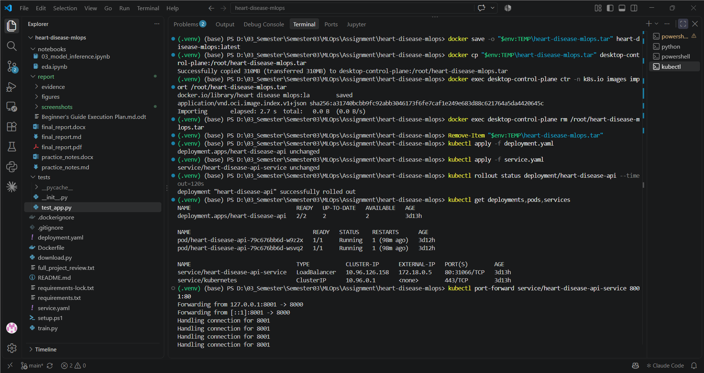

**Student Name:** Pitchaimani N | **Student ID:** 2025AE05341 | **Course No:** AIMLCZG523 / AIMLZG523 | **Course Title:** MLOps - Assignment 1

# Heart Disease Prediction MLOps Project Report

## 1. Project summary

This project implements an end-to-end MLOps workflow for the Cleveland Heart Disease dataset. The pipeline includes data acquisition and cleaning, exploratory data analysis (EDA), feature engineering, model comparison, MLflow experiment tracking, FastAPI serving, Docker containerization, Kubernetes deployment, GitHub Actions CI/CD, and a final written report. The goal is to design a reproducible, cloud-ready machine learning solution for heart disease risk prediction.

This system is built for academic and learning purposes. It is not a medical product and must not be used for actual clinical diagnosis or treatment decisions.

## 2. Setup and installation instructions

### 2.1 Clone and setup

```bash
git clone [https://github.com/PitchaimaniN/heart-disease-mlops.git](https://github.com/PitchaimaniN/heart-disease-mlops.git)
cd heart-disease-mlops
python -m venv .venv
.venv\Scripts\Activate.ps1
pip install -r requirements.txt
```

### 2.2 Prepare the data

```bash
python download.py
```

This downloads the Cleveland UCI data and saves:
- `data/raw/heart.csv`
- `data/processed/heart_clean.csv`

### 2.3 Train models and log experiments

```bash
python train.py
```

This compares Logistic Regression and Random Forest models, evaluates them using cross-validation and held-out metrics, and saves the best pipeline in `models/heart_disease_pipeline.joblib`.

### 2.4 Run the API locally

```bash
python -m uvicorn api.main:app --reload --no-access-log --host 127.0.0.1 --port 8000
```

Open the following endpoints:
- `http://127.0.0.1:8000/health`
- `http://127.0.0.1:8000/metrics`
- `http://127.0.0.1:8000/docs`

### 2.5 Run tests and linting

```bash
pytest -q tests
flake8 download.py train.py api tests
```

## 3. Architecture diagram

```text
+---------------------+      +-------------------------+
| GitHub Repository   | ---> | GitHub Actions CI/CD    |
| (code + notebooks)  |      | - download data         |
+---------------------+      | - linting               |
                              | - pytest                |
                              | - train model           |
                              +-----------+-------------+
                                              |
                                              v
                              +-------------------------+
                              | MLflow Experiment Store |
                              | Parameters, Metrics      |
                              | Plots, Artifacts        |
                              +-----------+-------------+
                                          |
                                          v
                              +-------------------------+
                              | Trained Model Pipeline  |
                              | (.joblib)              |
                              +-----------+-------------+
                                          |
                                          v
                              +-------------------------+
                              | FastAPI Service        |
                              | /health /metrics       |
                              | /predict               |
                              +-----------+-------------+
                                          |
                              +-----------+-------------+
                              | Docker Container        |
                              | Kubernetes Deployment   |
                              +-------------------------+
```

This architecture keeps the data pipeline, model tracking, and serving layer separate while allowing the same trained model to be reused in CI/CD and deployment stages.

## 4. Data acquisition and exploratory data analysis

The project uses the Cleveland Heart Disease dataset from the UCI Machine Learning Repository. The cleaned dataset contains 303 records and 13 predictor columns with one binary target.

| Target | Meaning | Records | Share |
| --- | --- | ---: | ---: |
| 0 | No heart disease | 164 | 54.13% |
| 1 | Heart disease | 139 | 45.87% |

The raw source contains missing entries encoded as `?`. In the cleaned dataset, these missing values are retained and later handled through median imputation inside the model pipeline. This avoids data leakage while preserving the original patient records for training.

### EDA findings
- The target class distribution is reasonably balanced.
- Missing values are concentrated in `ca` and `thal`.
- Histograms show feature distribution ranges and skew patterns.
- Correlation analysis helps identify the strongest observed relationships among features.
- The data is historical and not clinically validated for real-world diagnosis.

### EDA screenshots


<br><em>Figure 1. Feature histograms</em>


<br><em>Figure 2. Correlation heatmap</em>


<br><em>Figure 3. Class balance chart</em>

## 5. Feature engineering and model development

Two classification pipelines were trained and compared:
- Logistic Regression
- Random Forest Classifier

Both models use a leakage-safe pipeline consisting of:
1. median imputation for missing values
2. feature scaling
3. model training

The train/test split used is a stratified 80/20 split with `random_state=42`. Five-fold stratified cross-validation was used for model comparison on the training set.

### Model evaluation results

| Model | CV ROC-AUC (mean ± SD) | Test Accuracy | Test Precision | Test Recall | Test ROC-AUC |
| --- | ---: | ---: | ---: | ---: | ---: |
| Logistic Regression | 0.8960 ± 0.0148 | 0.8689 | 0.8125 | 0.9286 | 0.9513 |
| Random Forest | 0.8818 ± 0.0281 | 0.9016 | 0.8667 | 0.9286 | 0.9491 |

The selected model is Logistic Regression because it achieved the highest held-out test ROC-AUC in this project run. The saved model is stored in `models/heart_disease_pipeline.joblib` and the summary is saved in `models/training_summary.json`.

Note: because the same held-out test split is used for model selection and reporting, the reported test metrics may be optimistic and should not be interpreted as unbiased final evaluation metrics for future unseen data.

## 6. Experiment tracking with MLflow

MLflow is used for experiment tracking. Each run logs:
- model parameters
- evaluation metrics
- ROC plots
- saved model artifacts

The MLflow experiment is stored locally under `mlruns/`.



## 7. API service, monitoring, and logging

The FastAPI service exposes three core endpoints:
- `GET /health` - verifies model loading and service health
- `GET /metrics` - returns runtime counters and uptime metrics
- `POST /predict` - accepts patient input and returns prediction and probability

The prediction API validates:
- numeric ranges
- allowed categorical values
- rejection of `target` and unexpected fields

The service intentionally avoids logging patient fields or raw payloads. It logs only route, status, and generic prediction events to preserve privacy and reduce risk from sensitive operational data.

Example request payload:

```json
{
  "age": 52,
  "sex": 1,
  "cp": 2,
  "trestbps": 125,
  "chol": 212,
  "fbs": 0,
  "restecg": 1,
  "thalach": 168,
  "exang": 0,
  "oldpeak": 1.0,
  "slope": 2,
  "ca": 2,
  "thal": 3
}
```

### API screenshot



## 8. CI/CD workflow and automated testing

The GitHub Actions workflow performs the following steps on pushes and pull requests:
- check out repository
- set up Python 3.11
- install dependencies
- run `python download.py`
- run `python train.py`
- run `flake8`
- run `pytest -q`
- upload model artifacts and MLflow outputs

The workflow file is stored at `.github/workflows/main.yml`.



## 9. Docker containerization and deployment

### 9.1 Docker

The API is packaged in Docker using `Dockerfile` and can be built with:

```bash
docker build -t heart-disease-mlops .
docker run --rm --name heart-disease-api -p 8000:8000 heart-disease-mlops
```

The Docker image is ready for local deployment and validation.



### 9.2 Kubernetes deployment

The project includes `deployment.yaml` and `service.yaml` for Kubernetes deployment. A local cluster or Docker Desktop Kubernetes environment can expose the API via a LoadBalancer Service.

```bash
kubectl apply -f deployment.yaml
kubectl apply -f service.yaml
kubectl get deployments,pods,services
kubectl port-forward service/heart-disease-api-service 8001:80
```



## 10. Repository structure and deliverables

Key files in this project:
- `download.py` – data collection and cleaning
- `train.py` – model training and MLflow logging
- `api/main.py` – FastAPI service
- `Dockerfile` – container build definition
- `deployment.yaml` – Kubernetes deployment manifest
- `service.yaml` – Kubernetes service manifest
- `tests/` – pytest test suite
- `.github/workflows/main.yml` – CI/CD automation
- `report/` – report assets and screenshots

### Code repository

GitHub repository: https://github.com/PitchaimaniN/heart-disease-mlops

## 11. Final assessment and conclusion

This project demonstrates a complete MLOps lifecycle for a heart disease prediction task, including data preparation, model comparison, experiment tracking, serving, deployment, and monitoring. It satisfies the main assignment objectives by combining software engineering and machine learning operations into a reproducible workflow.

The implementation is modular, testable, and suitable for coursework demonstration. The project also highlights the importance of privacy-aware logging, artifact tracking, CI validation, and reproducible deployment patterns in real-world ML systems.

## 12. Evidence checklist

The assignment requirements are met through the following evidence:
- Setup/install instructions included
- EDA and model development documented
- MLflow tracking implemented and screenshot attached
- FastAPI API with metrics and prediction endpoints implemented
- Docker image built and validated
- Kubernetes deployment manifest included and validated locally
- GitHub Actions workflow implemented and screenshot attached
- Final report generated in Markdown and PDF format

This report is intended to accompany the repository implementation and provide a concise but complete overview of the project lifecycle.